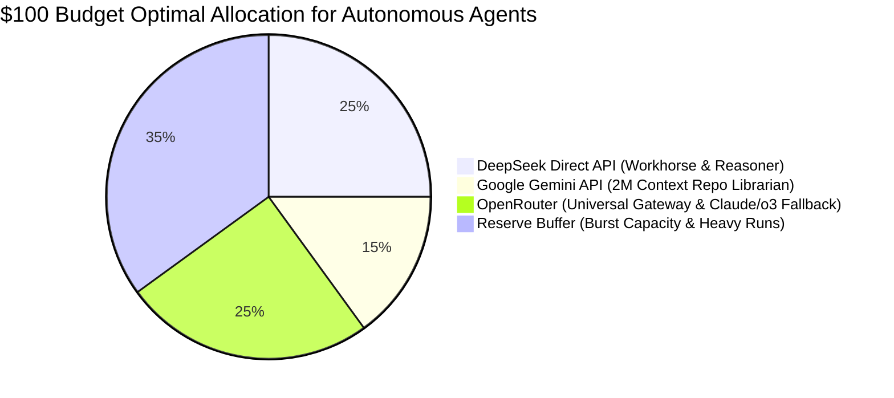
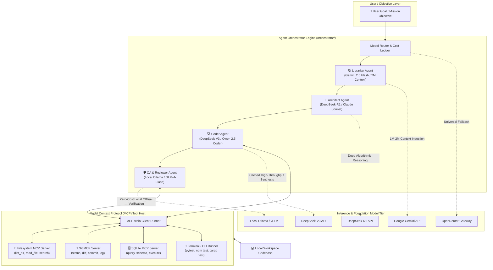

# 🤖 Autonomous AI Agent Architecture & $100 Budget Guide

A production-grade, highly curated blueprint for architecting, deploying, and operating **autonomous AI agents** across **local inference engines (Ollama / vLLM)**, **cloud frontier models (DeepSeek, Gemini, OpenRouter)**, and the **Model Context Protocol (MCP)** on a strict **$100 total budget**.

---

## ⚖️ 1. Executive Verdict: Monthly Subscriptions vs. Pay-As-You-Go

When engineering autonomous AI agents, multi-agent swarms, or continuous coding loops, **Pay-As-You-Go (PAYG / BYOK - Bring Your Own Key)** is the only viable, mathematically sound choice.

### Why Monthly Subscriptions Fail for Autonomous Agents

| Architectural Criterion | Monthly Seat Subscriptions (ChatGPT Plus, Claude Pro, Cursor Pro) | Pay-As-You-Go Direct APIs (DeepSeek, Gemini, OpenRouter) |
| :--- | :--- | :--- |
| **API Programmability** | ❌ **None.** Web chat UI only. Programmatic scraping violates Terms of Service and triggers account bans. | ✅ **Full REST & JSON-RPC.** Native OpenAI/Anthropic-compatible endpoints. |
| **Concurrency & Rate Limits** | ❌ **Rolling message caps.** Claude Pro throttles to ~45 messages / 5 hours. Cursor Pro enforces daily fast-request caps. | ✅ **High throughput.** Non-blocking Tier-1/2 TPM limits allowing hundreds of parallel agent turns. |
| **Loop Endurance** | ❌ **Exhausted in 30–60 minutes.** A recursive agent checking tests or editing multi-file ASTs hits subscription limits immediately. | ✅ **Runs 24/7 uninterrupted.** The agent continues processing until tasks are verified or budget thresholds are reached. |
| **Token Economics ($100 Run)** | ❌ **$60 spent on 3 seat licenses** yields **0 programmable API tokens** for custom scripts or CLI agents. | ✅ **$100 yields 500 Million to 1 Billion+ tokens** leveraging prompt caching. |
| **Model Context Protocol (MCP)** | ❌ Locked inside closed vendor desktop containers. | ✅ Direct stdio / SSE integration across local filesystems, Git, and databases. |
| **Multi-Provider Cascades** | ❌ Vendor lock-in. Cannot route between reasoning, coding, and context models dynamically. | ✅ Dynamic fallback routing (e.g., DeepSeek-R1 for reasoning ➔ DeepSeek-V3 for coding ➔ Gemini for 2M context). |

---

## 💰 2. Optimal $100 Budget Allocation Strategy

With modern **prompt caching**, agentic loops achieve 90%–99.5% cache hit ratios on multi-turn conversations and codebase contexts. This stretches a $100 budget to over **1 Billion tokens** of effective computation.



### Detailed Cost & Token Allocation Breakdown

| Provider / Tier | Allocated Budget | Primary Role in Agent Architecture | Unit Cost (per 1M tokens) | Estimated Effective Tokens |
| :--- | :---: | :--- | :--- | :--- |
| **Local Inference (Ollama / vLLM)** | **$0.00** | Zero-cost edge worker, offline preprocessing, test runner, AST linting | **$0.00** (Free on local hardware) | **Unlimited** |
| **[DeepSeek Direct API](https://www.deepseek.com)** | **$25.00** | Primary coding agent (`deepseek-chat`) + deep reasoning planner (`deepseek-reasoner`) | **$0.003 – $0.014** (Cached input)<br>$0.28 – $0.60 (Output) | **~500M – 800M+ tokens** |
| **[Google AI (Gemini 2.0 Flash)](https://ai.google.dev)** | **$15.00** | "Repo Librarian" — Ingesting entire 1M–2M token codebases, logs, and technical specs | Free tier (15 RPM) + **$0.10** / 1M input (**$0.025** cached) | **~100M – 150M tokens** |
| **[OpenRouter Gateway](https://openrouter.ai)** | **$25.00** | High-precision surgical fallback for Claude 3.5/3.7 Sonnet, OpenAI o3-mini, and Qwen 2.5 | Pay-per-call (Dynamic) | **~10M – 25M flagship tokens** |
| **Reserve Buffer** | **$35.00** | Retained in your digital wallet to refill whichever provider experiences peak load | N/A | Flexible safety runway |
| **Total** | **$100.00** | **Complete Full-Stack Autonomous Agent Runway** | — | **500M – 1B+ Effective Tokens** |

---

## 🏗️ 3. Full-Stack System Architecture



---

## ⚡ 4. Architectural Roles & Dynamic Cascading

To prevent runaway token consumption and ensure high-fidelity software output, autonomous agent tasks are partitioned into strict hierarchical stages:

### Step 1: The Repo Librarian (Context Ingestion)
* **Assigned Engine:** `gemini-2.0-flash` (Cloud) or `qwen2.5-coder:7b` (Local).
* **Execution:** Reads file trees, parses configuration files, and analyzes documentation without requiring expensive vector database embeddings. With a 1M–2M context window, Gemini ingests entire repositories in a single turn for less than $0.05.

### Step 2: The Architect & Reasoner (Planning & Verification)
* **Assigned Engine:** `deepseek-reasoner` (DeepSeek-R1) via Direct API.
* **Execution:** Generates a step-by-step implementation plan, evaluates edge cases, and verifies mathematical/algorithmic soundness before any code is generated. Costs $0.55 / 1M input tokens.

### Step 3: The Coder (Implementation & MCP Tool Calls)
* **Assigned Engine:** `deepseek-chat` (DeepSeek-V3) or `claude-3-5-sonnet` (via OpenRouter on-demand).
* **Execution:** Calls MCP tools (`read_file`, `write_file`, `apply_patch`) iteratively. Benefiting from 99%+ prompt cache hit ratios, repeated file contents cost as low as **$0.003 / 1M tokens**.

### Step 4: The QA & Verification Loop (Zero-Cost Local Feedback)
* **Assigned Engine:** Local `ollama run qwen2.5-coder:7b` or `deepseek-r1-distill:8b`.
* **Execution:** Runs unit tests, lints the syntax, and parses compiler error outputs locally at **$0.00 cost**, feeding any failed tracebacks back to the Coder agent until all tests pass.

---

## 🚀 5. Quick-Start Deployment Guide

The **IntelliBitz Archives** repository includes production-ready code for every layer of this architecture:

### 1. Configure API Credentials
Create a `.env` file in the repository root:
```bash
# DeepSeek API (Primary Workhorse)
DEEPSEEK_API_KEY="sk-..."

# Google Gemini API (Librarian Context)
GEMINI_API_KEY="AIzaSy..."

# OpenRouter (Universal Gateway)
OPENROUTER_API_KEY="sk-or-v1-..."

# Local Inference Endpoint (Ollama default)
OLLAMA_API_BASE="http://localhost:11434/v1"
```

### 2. Verify Provider Status
Run the orchestrator CLI status dashboard:
```bash
# Windows PowerShell
python -m orchestrator.cli --status

# Linux / macOS
./orchestrator.sh --status
```

### 3. Test MCP Tool Connectivity
Verify that the stdio MCP client can communicate with the filesystem server:
```bash
python mcp/clients/mcp_client.py --server "python mcp/servers/filesystem_server.py"
```

### 4. Execute an Autonomous Multi-Agent Goal
Execute an autonomous software engineering workflow with automated role routing:
```bash
python -m orchestrator.cli --task "Build a robust SQLite caching layer with unit tests and MCP file tool calling"
```
