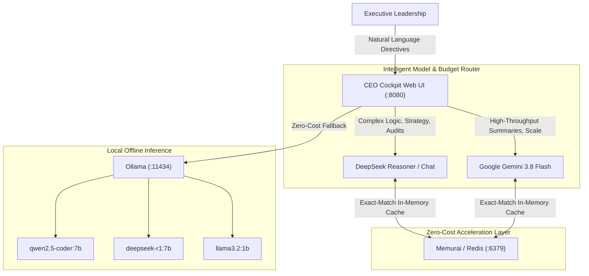

# Antigravity CEO Cockpit — Executive AI OS Mission Control

Executive control plane designed specifically for executive leadership who command AI operations without writing or inspecting code.

---

## 1. Quick Access Links

* **Live Web Cockpit:** [http://localhost:8080](http://localhost:8080)
* **LiteLLM Model Catalog:** [http://localhost:4000/v1/models](http://localhost:4000/v1/models)
* **Qdrant Neural Dashboard:** [http://localhost:6333/dashboard](http://localhost:6333/dashboard)

---

## 2. Architecture & Service Topology



---

## 3. Project Structure

```
ceo-cockpit/
├── web/                           # Executive Web Interface (Glassmorphic HUD)
│   ├── index.html                 # Single-page executive cockpit
│   ├── style.css                  # Modern dark-mode styling
│   └── app.js                     # Frontend event & telemetry controller
├── server.py                      # Production mission control API server (:8080)
├── budget_governor.py             # Autonomous spend governor & circuit-breaker engine
├── config/
│   └── budget_governor.json       # Live budget ledger, spend caps, and audit log
├── scripts/
│   ├── start_cockpit.ps1          # One-click launch script
│   ├── register_service.ps1       # Register as automatic Windows background service
│   └── verify_health.ps1          # Health check & latency verification script
├── .agents/plugins/ceo-cockpit/   # Antigravity IDE plugin & ceo-harness skill
└── README.md                      # Executive project guide
```

---

## 4. Operational Scripts

### Launch Locally:
```powershell
.\scripts\start_cockpit.ps1
```

### Run Full Infrastructure Health Check:
```powershell
.\scripts\verify_health.ps1
```

### Install / Update Windows Background Service:
```powershell
gsudo powershell -ExecutionPolicy Bypass -File .\scripts\register_service.ps1
```

---

## 5. Model Routing & Budget Efficiency

| Task Type | Target Model | Rationale & Cost Impact |
| :--- | :--- | :--- |
| **Deep Reasoning & Strategy** | `deepseek-reasoner` / `deepseek-chat` | Frontier logic at ~$0.14 - $0.55/M tokens. |
| **High-Speed Synthesis & Memos** | `gemini-3.8-flash` | Sub-second briefs with 1M context at ~$0.075/M tokens. |
| **Repeated Directives** | `Redis In-Memory Cache` | Served in ~20ms with **$0.00 token cost**. |
| **Local / Offline Fallback** | `local-coder` / `local-reasoner` | Ollama on the local GPU, **$0.00 token cost**. |
